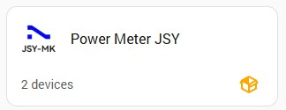

  

<h1 align="center">⚡ Power Meter JSY for Home Assistant</h1>

  <b>
  Multi-device Modbus integration for <a href="https://jsypowermeter.com" target="_blank" rel="noopener noreferrer">JSY Power Meter devices</a>.
  </b>

## v1.01.02

## 📋 Changes
- Removed the forced reconnect of the core Modbus hub in “Existing Modbus Node” mode. The integration no longer touches the private internals of the core modbus integration.
- If the selected Modbus hub is not connected, this is now only reported through the error code sensor. Reconnecting is left to the core Modbus integration (this may take up to 60 s after switching a node from USB to an existing Modbus hub).
- Manifest: added after_dependencies: ["modbus"] and sorted the keys (Hassfest).