<p align="center">
  
</p>

<h1 align="center">⚡ Power Meter JSY for Home Assistant</h1>

<p align="center">
  Multi-device Modbus integration for <b>JSY Power Meter devices</b><br>
</p>

<p align="center">

[](https://hacs.xyz)
[](https://github.com/jozef-moravcik-homeassistant/power-meter-jsy/releases)
[](LICENSE)
[](https://www.home-assistant.io)
[](https://developers.home-assistant.io/docs/creating_integration_manifest/#iot-class)

</p>

---

## 📋 Table of Contents

- [🎯 Overview](#-overview)
- [✨ Features](#-features)
- [🧩 How it works – the three device types](#-how-it-works--the-three-device-types)
- [💾 Installation](#-installation)
- [🔩 Configuration](#-configuration)
  - [Step 1 – Add a Modbus Node](#step-1--add-a-modbus-node)
  - [Step 2 – Add a Power Meter](#step-2--add-a-power-meter)
  - [Step 3 – (optional) Tools wizard](#step-3--optional-tools-wizard)
- [🧰 Setting the Modbus Device ID and communication parameters](#-setting-the-modbus-device-id-and-communication-parameters)
- [📊 Entities](#-entities)
- [🏭 Example topologies](#-example-topologies)
- [🔧 Changing the configuration later](#-changing-the-configuration-later)
- [🌍 Languages](#-languages)
- [🩺 Troubleshooting](#-troubleshooting)
- [🔬 Technical details](#-technical-details)
- [🚨 Disclaimer](#-disclaimer)
- [🤝 Support](#-support)

---

## 🎯 Overview

**Power Meter JSY** reads energy-monitoring data from **JSY Power Meter devices (e.i.JSY-MK-138)** multi-channel AC power meters over **Modbus** and exposes it as native Home Assistant sensors – voltage, current, active power, total active energy, power factor and frequency for **each of the measuring channels**. Everything is read locally; no cloud, no account.

The integration is built for **real-world installations**, not just a single meter on a single cable. It lets you combine, in one Home Assistant instance, any number of meters that are connected in different ways – for example:

- one meter on a **USB–RS485 adapter** plugged into the Home Assistant host,
- another meter behind an **RS485-to-Ethernet gateway** (Modbus **TCP** or **UDP**),
- a third meter reachable through a **Modbus hub you already defined** in `configuration.yaml`,
- several meters with different Modbus IDs **sharing one RS485 bus**.

### 🔌 Currently Supported hardware

| Model | Channels | Status |
|-------|:--------:|--------|
| **JSY-MK-138** | 12 | ✅ Supported |
| Other JSY devices | – | 🔜 **Planned – more devices from the same manufacturer will be added in the near future** |

> The integration identifies the model automatically by reading the device model and creates only the entities and configuration profile that the model really supports. Adding further JSY models therefore does not change how you configure anything.

---

## ✨ Features

- 🔌 **Four connection types** – USB / RS485 serial, Modbus TCP, Modbus UDP, or an existing Home Assistant Modbus hub.
- 🧩 **Three device types** – *Modbus Node* (the connection), *Power Meter* (the meter), *Tools* (the setup wizard) – see below.
- 📈 **72 measurement sensors per meter** (12 channels × 6 quantities) plus diagnostic sensors.
- 🚀 **One Modbus packet per update** – All 84 measurement registers are read in a single request, which saves RS485 bus capacity.
- 🔁 **Support for complex infrastructure** – Multiple electricity meters can share a single Modbus node (using different IDs within the Modbus protocol), but they can also be connected to different nodes with distinct hardware connections.
- 🧙 **Built-in setup wizard** – change the **Modbus Device ID** and the **communication parameters** (baud rate, 8N1 / 8E1 / 8O1 / 8N2) of a meter directly from Home Assistant, with automatic verification.
- 🎛️ **Flexible assignment of phases to channels** – tell each current channel which voltage phase (A / B / C) it measures; the assignment is written to the device.
- 🛡️ **Robust communication** – automatic reconnect, retries, minimum packet gap, hard read time-out, and a log that is not flooded when a device is offline.
- 🔗 **Device hierarchy** – every Power Meter is linked to the Modbus Node it uses (*Connected via …*).
- 🌍 **11 languages** built in.

---

## 🧩 How it works – the device types

<p align="center">
  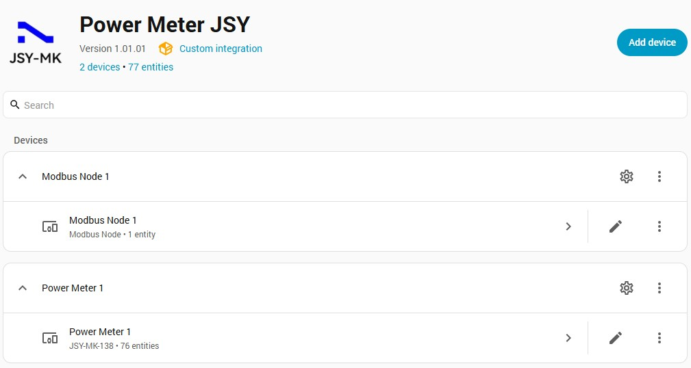
</p>

When you press **Add device** you are asked what kind of device you want to add. The integration deliberately separates *how you connect* from *what you measure*. This is what makes complex installations possible.

### 🔌 Modbus Node – the connection

A **Modbus Node** represents **one Modbus line** (one USB/RS485 adapter, one TCP/UDP gateway, or one existing Modbus hub). It holds the connection settings and owns the physical link.

<p align="center">
  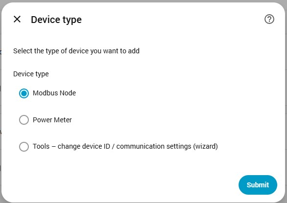
</p>

- It talks to the line **one request at a time**, so any number of Power Meters can safely share it.
- It provides a diagnostic **Error code** sensor that tells you whether the port could be opened and whether the device answered.
- You create it **once per physical line**, not once per meter.

### ⚡ Power Meter – the meter

<p align="center">
  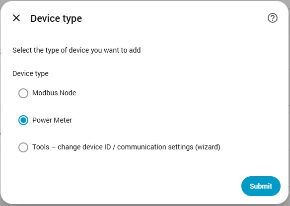
</p>

A **Power Meter** represents **one JSY physical device - power meter**. It is linked to a Modbus Node and has its own **Modbus Device ID** (slave address) and **read interval**. It creates all the measurement sensors and lets you configure the phase assignment of the channels.

- The model, voltage range and current range are read from the device when you add it.
- You create one Power Meter per physical meter – even when ten of them share the same RS485 bus.

### 🧙 Tools – the setup wizard


<p align="center">
  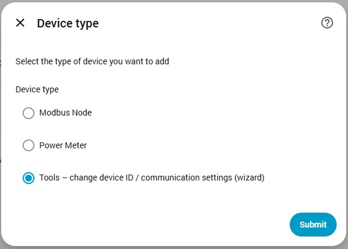
</p>

**Tools** is a wizard, not a device – it never creates anything in Home Assistant. Use it to **change the Modbus Device ID and the communication parameters** (baud rate, data format) that are stored **inside the meter**. It is the way to prepare a brand-new meter (factory settings: ID 1, 9600 baud, 8N1) for a bus that already contains other meters.

> 💡 **Why this design?**
> Separating the connection (*Modbus Node*) from the meter (*Power Meter*) means a single Home Assistant instance can run a large, mixed infrastructure: for example 2 meters on a USB adapter in the cabinet, 3 meters behind a LAN gateway in the workshop and 1 meter on a Modbus hub you already had. Each line is configured once; each meter just points to its line.

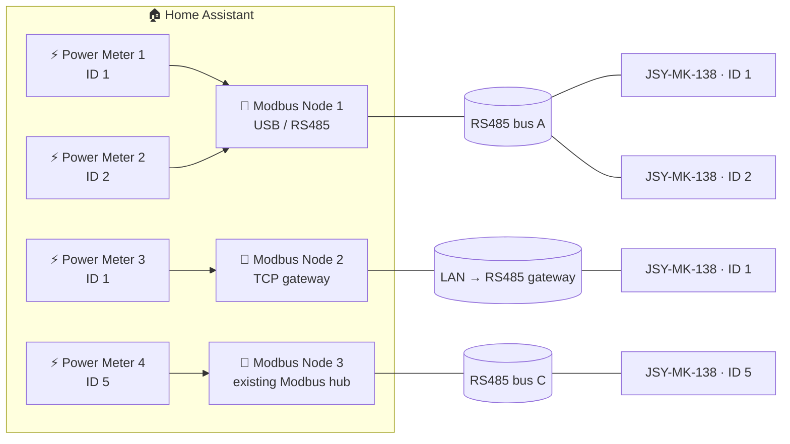

---

## 💾 Installation

### Option A – HACS (custom repository) 🟠

1. Open **HACS** in Home Assistant.
2. Open the menu (⋮) in the top right and choose **Custom repositories**.
3. Add `https://github.com/jozef-moravcik-homeassistant/power-meter-jsy` with the category **Integration**.
4. Search for **Power Meter JSY** in HACS and click **Download**.
5. **Restart Home Assistant.**

### Option B – Manual installation 📁

1. Download the latest release from the [Releases page](https://github.com/jozef-moravcik-homeassistant/power-meter-jsy/releases).
2. Copy the folder `power_meter_jsy` into the `custom_components` folder of your Home Assistant configuration, so that you get:

   ```text
   config/
   └── custom_components/
       └── power_meter_jsy/
           ├── __init__.py
           ├── manifest.json
           └── …
   ```
3. **Restart Home Assistant.**

### Requirements

The Python libraries `pyserial` and `pymodbus` are installed automatically by Home Assistant (see `manifest.json`). A USB–RS485 adapter is required only if you want to use the **USB** connection type.

---

## 🔩 Configuration

Everything is configured in the user interface – no YAML is needed.

1. Go to **Settings → Devices & services → Add integration** and search for **Power Meter JSY**.
2. Choose the **device type** and follow the dialogs.

<p align="center">
  
</p>

> 🧭 **Recommended order:** create the **Modbus Node(s)** first, then add a **Power Meter** for every meter and select its Node. A Power Meter cannot be added before at least one Modbus Node exists.

### Step 1 – Add a Modbus Node

Select **Modbus Node** as the device type and pick the **connection type**. The Node gets an automatic name (*Modbus Node 1*, *Modbus Node 2*, …).

| Connection type | Use it when … |
|-----------------|---------------|
| 🔌 **USB Port** | The meter is wired (RS485) to a USB–RS485 adapter plugged into the Home Assistant host. |
| 🌐 **TCP Server** | The meter is connected through an RS485-to-Ethernet gateway working as a Modbus TCP server. |
| 📡 **UDP Server** | The gateway exposes the line as Modbus UDP. |
| 🔗 **Existing Modbus Node** | You already have a Modbus hub defined in `configuration.yaml` (core *Modbus* integration) and want to reuse it. |

#### 🔌 USB Port

<p align="center">
  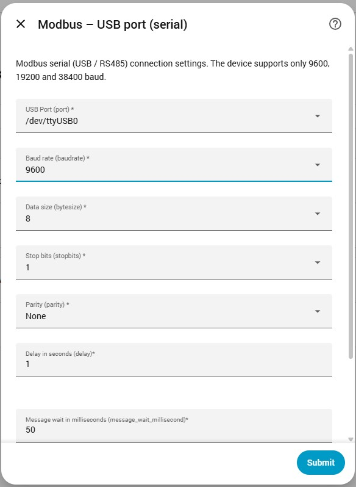
</p>

| Field | Description | Default |
|-------|-------------|---------|
| **USB Port (port)** | Serial port, e.g. `/dev/ttyUSB0`. Only ports that exist on the host are offered. | first free port |
| **Baud rate (baudrate)** | `9600`, `19200` or `38400` – the only rates the meter supports. | `9600` |
| **Data size (bytesize)** | Number of data bits. The JSY-MK-138 always uses **8**. | `8` |
| **Stop bits (stopbits)** | `1` or `2`. | `1` |
| **Parity (parity)** | `None`, `Even`, `Odd`. | `None` |
| **Delay (delay)** | Reserved for compatibility with the Home Assistant Modbus hub settings. | `1` s |
| **Message wait (message_wait_millisecond)** | Reserved for compatibility. The integration keeps its own minimum gap of 0.2 s between two packets to the same device. | `50` ms |
| **Timeout (timeout)** | How long to wait for an answer. | `1` s |

> ⚠️ **The serial parameters must match the meter.** The factory setting of the JSY-MK-138 is **9600 baud, 8 data bits, no parity, 1 stop bit (8N1)**. If you changed the meter's settings (see [Tools](#-setting-the-modbus-device-id-and-communication-parameters)), enter the same values here.

> 🔒 **One owner per serial port.** A serial port can be opened by only one program at a time. A port that is already used by a Modbus hub defined in `configuration.yaml` is **not offered** in the list. If you want to use that adapter here, remove the hub from `configuration.yaml` – or simply choose the **Existing Modbus Node** connection type and reuse the hub.

#### 🌐 TCP Server / 📡 UDP Server

<p align="center">
  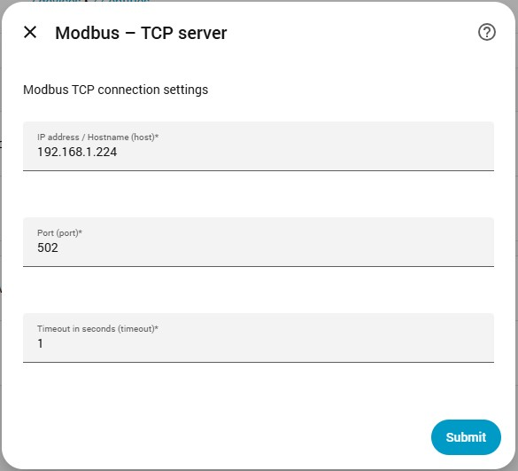
  &nbsp;
  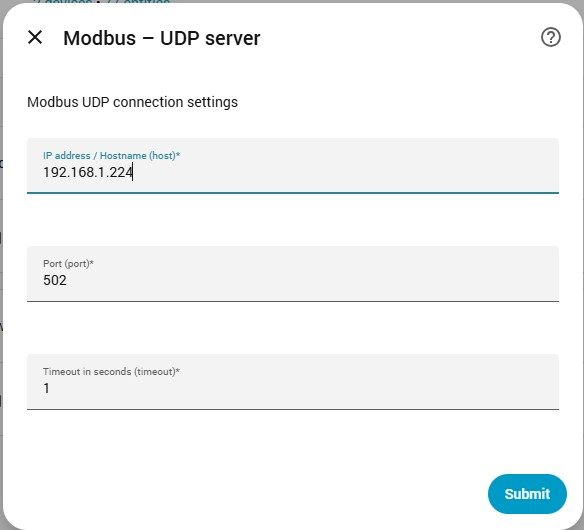
</p>

| Field | Description | Default |
|-------|-------------|---------|
| **IP address / Hostname (host)** | Address of the gateway. | – |
| **Port (port)** | TCP/UDP port of the gateway. | `502` |
| **Timeout (timeout)** | How long to wait for an answer. | `1` s |

> ℹ️ With TCP and UDP the RS485 side (baud rate, parity, stop bits) is configured **in the gateway**, not in Home Assistant. Make sure the gateway uses the same serial parameters as the meter.

#### 🔗 Existing Modbus Node

<p align="center">
  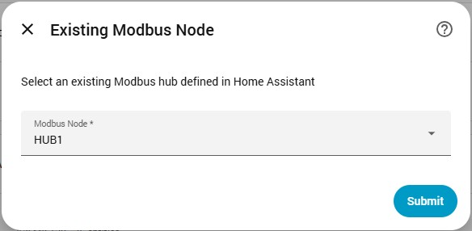
</p>

Select one of the Modbus hubs that are already defined in Home Assistant (the hub `name` from your `modbus:` configuration). All serial/network parameters are then taken from that hub. If no hub exists you will see the message *"No Modbus nodes were found in the system"*.

```yaml
# configuration.yaml – an example of a hub that can be selected
modbus:
  - name: HUB1
    type: serial
    port: /dev/ttyUSB0
    baudrate: 9600
    bytesize: 8
    method: rtu
    parity: N
    stopbits: 1
```

### Step 2 – Add a Power Meter

Select **Power Meter** as the device type. The dialogs are:

**1️⃣ Power Meter settings**

<p align="center">
  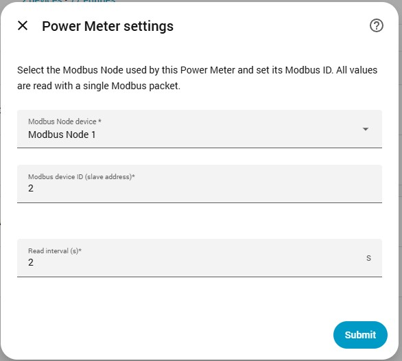
</p>

| Field | Description | Default / range |
|-------|-------------|-----------------|
| **Modbus Node device** | The Modbus Node (line) the meter is connected to. | – |
| **Modbus device ID (slave address)** | The Modbus ID of **this** meter on its line. Must be unique on one Node. | `1` (1 – 254) |
| **Read interval (s)** | How often the meter is read. The meter answers slowly, therefore the minimum is 2 seconds. | `2` s (2 – 100000) |

When you submit, the integration contacts the meter. If it cannot be read you get *"Cannot read the device. Check the Modbus Node, Modbus ID and wiring."*. If another Power Meter already uses the same ID on the same Node, you get *"A Power Meter with this Modbus ID already exists on the selected Modbus Node."*.

**2️⃣ Device parameters (confirmation)** – the integration shows what it read from the meter: **model**, **voltage range** and **current (circuit) range**. Confirm to continue.

**3️⃣ Phase assignment**

<p align="center">
  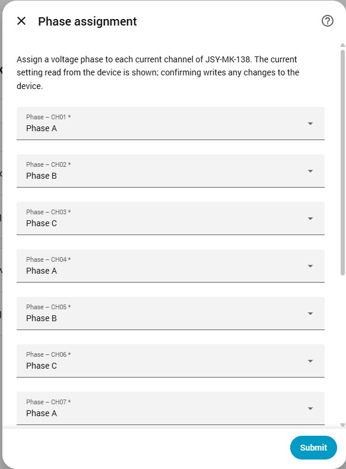
</p>

The JSY-MK-138 measures **up to 12 current channels** against **three voltage inputs (phases A, B and C)**. For each channel, select the phase to which it is connected (**Phase A / B / C**). The physical device allows for very flexible assignment of phases to channels, so you can configure this assignment according to your requirements. When you confirm, any change is **written to the physical device** and verified by reading it back (configuration check). Choose the phase that really supplies the circuit measured by that current channel, so that the meter measures it against the correct voltage.

After the last dialog the Power Meter is created together with all its entities (see [Entities](#-entities)).

### Step 3 – (optional) Tools wizard

Select **Tools – change device ID / communication settings (wizard)** to change the Modbus ID or the serial parameters stored in a meter. The full procedure is described in the next chapter.

---

## 🧰 Setting the Modbus Device ID and communication parameters

Every JSY meter stores its own **Modbus Device ID** and **serial communication parameters**. A new meter ships with **ID 1, 9600 baud, 8N1**. When several meters share one RS485 bus, every one of them needs a **different ID**; and all devices on one bus must use the **same baud rate and data format**.

The **Tools** wizard changes these values safely and verifies the result.

<p align="center">
  
</p>

### 📖 Supported parameters

| Parameter | Possible values |
|-----------|-----------------|
| **Modbus Device ID** | 1 – 254 |
| **Baud rate** | 9600 · 19200 · 38400 |
| **Data format** | 8N1 · 8E1 · 8O1 · 8N2 |

The data formats mean:

| Format | Data bits | Parity | Stop bits |
|:------:|:---------:|:------:|:---------:|
| **8N1** *(factory default)* | 8 | None | 1 |
| **8E1** | 8 | Even | 1 |
| **8O1** | 8 | Odd | 1 |
| **8N2** | 8 | None | 2 |

### 🧭 Step-by-step procedure

> ⚠️ **Wire only what you need.** For a first-time setup connect **only the meter you want to change** (see *Broadcast write* below), or make sure its current ID is unique on the bus.

**1️⃣ Start the wizard.** *Settings → Devices & services → Power Meter JSY → Add device → Tools – change device ID / communication settings (wizard).*

> ⏸️ **Polling is paused.** While you are in the Tools wizard, the integration **pauses reading of all Modbus Nodes and Power Meters** and releases their connections, so that nothing collides with the wizard. Normal reading resumes automatically when you finish or cancel the wizard.

**2️⃣ Choose how you connect to the meter.**

<p align="center">
  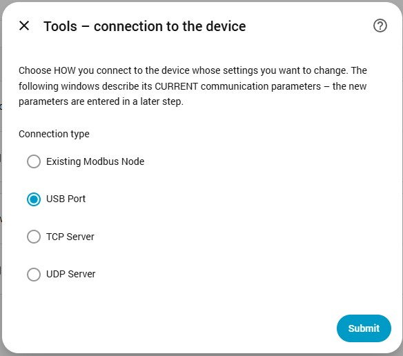
</p>

Choose **USB Port**, **TCP Server**, **UDP Server** or **Existing Modbus Node**. The following dialogs describe the meter's **CURRENT** communication parameters – the ones it uses *right now*.

**3️⃣ Enter the CURRENT connection parameters.**

<p align="center">
  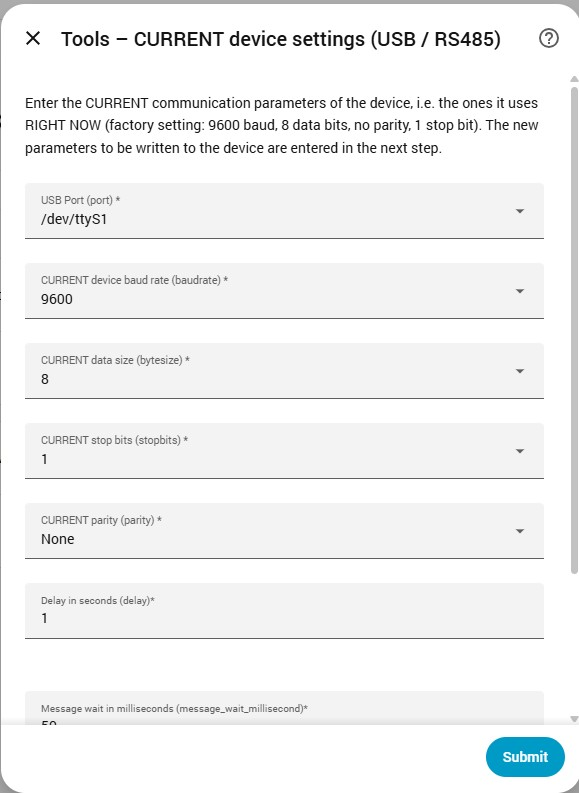
  &nbsp;
  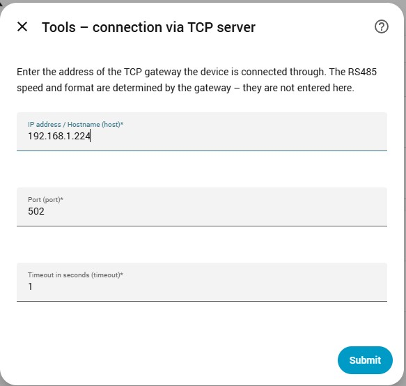
</p>

- **USB** – select the port and enter the **current** baud rate, data size, stop bits and parity of the meter (factory: 9600, 8, 1, None).
- **TCP / UDP** – enter the address and port of the gateway. The serial speed and format are determined by the gateway, so they are **not** entered here.
- **Existing Modbus Node** – select the hub. Speed and format are determined by that hub.

**4️⃣ Enter the CURRENT Modbus ID of the meter.**

<p align="center">
  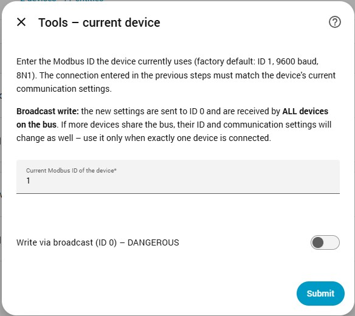
</p>

Enter the ID the meter uses now (a new meter: **1**). The integration reads the meter to prove that the connection and the ID are correct. If it cannot be read you will see *"Cannot read the device. Check the Modbus Node, Modbus ID and wiring."*.

> 🚨 **Write via broadcast (ID 0) – DANGEROUS.**
> If you do not know the meter's current ID (or the ID is lost), you can switch on *Write via broadcast*. The new settings are then sent to **ID 0**, which is received by **ALL devices on the bus**. If more than one device is connected they **all** receive the same new ID and communication settings. Use this option **only when exactly one meter is connected**.

**5️⃣ Enter the NEW settings.**

<p align="center">
  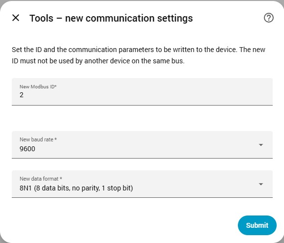
</p>

| Field | Description |
|-------|-------------|
| **New Modbus ID** | The ID to store in the meter. It must **not** be used by another device on the same bus. |
| **New baud rate** | 9600, 19200 or 38400. |
| **New data format** | 8N1, 8E1, 8O1 or 8N2. |

If the new settings are identical to the current ones (USB connection) the wizard answers *"The new settings are the same as the current ones."*.

**6️⃣ Confirm.** The wizard shows a summary – target ID, model and the change *ID 1 → 2, 9600 → 19200 baud, 8N1 → 8E1*. Confirm to write the settings.

**7️⃣ Wait for the verification.** The settings are sent as **one write**, once device saves the new settings, the wizard reads the meter again **with the new parameters** to check that they were really applied.

### 🏁 Possible results

| Result | Meaning | What to do |
|--------|---------|------------|
| ✅ **Done** – the device now responds with the new ID, baud rate and format | The change was applied **and verified**. | Continue with *After the change* below. |
| ⏳ **Pending** – the meter acknowledged the settings but still answers with the **old** ones | The new settings may become active only after the meter is **power-cycled**. | Switch the meter off and on, then use the new values. |
| ❓ **Unreachable** – the meter answers neither with the old nor with the new settings | The result could not be verified. The settings may have been applied. | Try the **new** settings. If the meter cannot be reached at all, try the **factory defaults**: ID 1, 9600 baud, 8N1. |
| ℹ️ **Unverified** (TCP / UDP / existing hub) | The link settings of a gateway or hub are fixed, so a change of **baud rate or data format cannot be verified** from Home Assistant. A changed **ID** is verified. | Set the same serial parameters on the gateway / hub, then check that the meter responds. |

### 🔄 After the change

1. **Modbus Node** – make the Modbus Node (or your TCP/UDP gateway / existing hub) use the **same baud rate, parity and stop bits** as the meter now uses.
2. **Power Meter** – if the meter is already added as a Power Meter and you changed its **ID**, open the Power Meter *Configure* dialog and enter the **new Modbus device ID**.

### 🧪 Typical scenarios

**Adding a second meter to an existing RS485 bus**

1. Connect the new meter **alone** to the bus (or to a separate adapter). It answers as ID 1.
2. Run **Tools** → *USB Port* → current ID **1** → new ID **2** (same baud rate and format as the rest of the bus).
3. Connect it to the common bus and add a **Power Meter** with ID **2** on the existing Modbus Node.

**Changing the speed of a whole bus**

1. Change the settings of every meter one by one with Tools (new baud rate / format).
2. Update the Modbus Node to the same parameters.
3. Update the Power Meters if any ID has changed.

**Unknown ID / lost settings** – connect **only** the affected meter and use *Write via broadcast*.

---

## 📊 Entities

### 🔌 Modbus Node

| Entity | Description |
|--------|-------------|
| **Error code** (diagnostic) | A bit mask describing the last communication error. `0` = no error. |

| Bit / value | Meaning |
|:-----------:|---------|
| `0` | ✅ No error |
| `1` (bit 0) | ❌ The port or connection could not be opened |
| `2` (bit 1) | ❌ Communication with the device failed |
| `128` (bit 7) | ❌ Unknown error |

Values are combined by addition (e.g. `3` = port error and communication error).

### ⚡ Power Meter – measurement sensors

For **every channel CH01 … CH12** the integration creates six sensors – **72 sensors** per meter.

| Sensor | Unit | Resolution | Device class | State class |
|--------|:----:|:----------:|--------------|-------------|
| 🔌 **Voltage – CHxx** | V | 0.1 V | `voltage` | `measurement` |
| 〰️ **Current – CHxx** | A | 0.001 A | `current` | `measurement` |
| ⚡ **Active power – CHxx** | W | 1 W | `power` | `measurement` |
| 🔢 **Total active energy – CHxx** | kWh | 0.01 kWh | `energy` | `total_increasing` |
| 📐 **Power factor – CHxx** | – | 0.001 | `power_factor` | `measurement` |
| 🎚️ **Frequency – CHxx** | Hz | 0.01 Hz | `frequency` | `measurement` |

The *Total active energy* sensors can be used directly in the **Energy dashboard**.

<p align="center">
  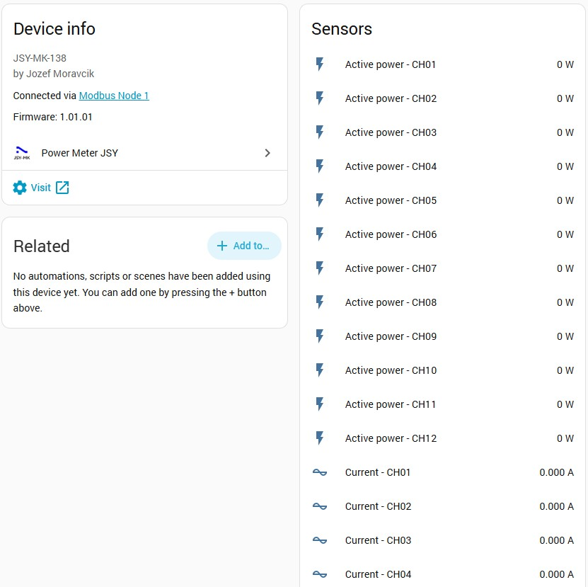
</p>

<details>
<summary><b>📷 More screenshots of the sensors</b></summary>

<p align="center">
  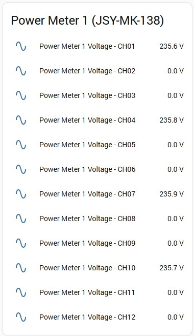
  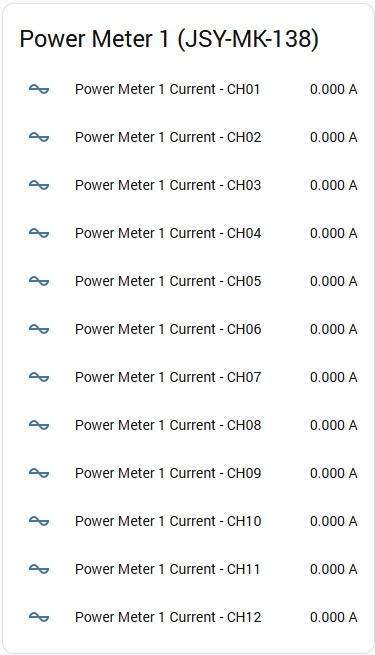
  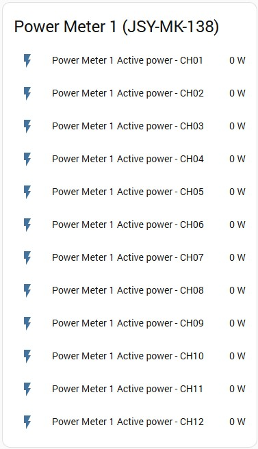
  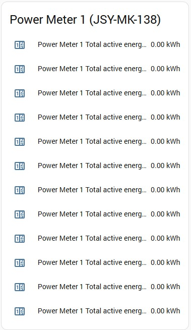
  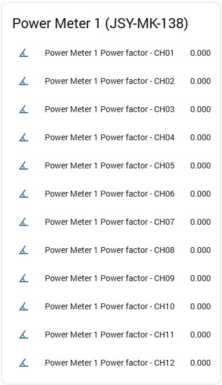
  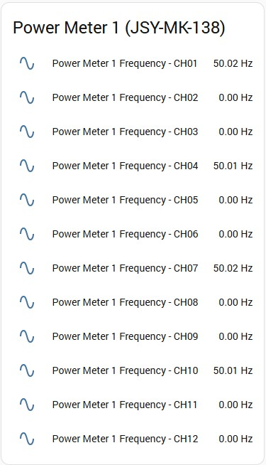
</p>

</details>

#### ✔️ Data validity

- Values outside the physically valid range are shown as **unavailable** instead of misleading numbers.
- **Frequency** reads **0 Hz** when the channel voltage is below **20 V** (voltage input not connected / no signal), instead of showing noise.
- If the meter cannot be read, all its sensors become **unavailable** and return automatically once communication is restored.

### 🩺 Power Meter – diagnostic sensors

<p align="center">
  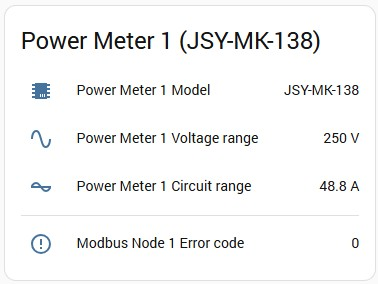
</p>

| Entity | Description | Enabled by default |
|--------|-------------|:------------------:|
| **Model** | Detected model, e.g. `JSY-MK-138`. | ✅ |
| **Voltage range** | Voltage range of the meter in V (e.g. 250 V). | ✅ |
| **Circuit range** | Current range of the meter in A. | ✅ |
| **Raw data** | The raw register block as an attribute (for debugging). | ❌ (enable it manually) |

### 🏷️ Naming

| Object | Name | Entity ID pattern |
|--------|------|-------------------|
| Modbus Node | `Modbus Node N` | `sensor.power_meter_jsy_node_N_error_code` |
| Power Meter | `Power Meter N` | `sensor.power_meter_jsy_N_channelCC_<quantity>` |

Example: `sensor.power_meter_jsy_1_channel03_power` is the active power of channel 3 of Power Meter 1. The quantity is one of `voltage`, `current`, `power`, `energy`, `power_factor`, `frequency`.

---

## 🏭 Example topologies

### 1️⃣ One meter, one USB adapter

`Modbus Node 1` (USB, `/dev/ttyUSB0`, 9600 8N1) → `Power Meter 1` (ID 1)

### 2️⃣ Several meters on one RS485 bus

`Modbus Node 1` (USB) → `Power Meter 1` (ID 1), `Power Meter 2` (ID 2), `Power Meter 3` (ID 3)

Give each meter a unique ID with the **Tools** wizard before connecting it to the shared bus.

### 3️⃣ Mixed infrastructure

| Location | Modbus Node | Meters |
|----------|-------------|--------|
| Main distribution board | `Modbus Node 1` – **USB** adapter | `Power Meter 1` (ID 1), `Power Meter 2` (ID 2) |
| Workshop | `Modbus Node 2` – **TCP** gateway `192.168.1.224:502` | `Power Meter 3` (ID 1) |
| Garage | `Modbus Node 3` – **Existing Modbus Node** `HUB1` | `Power Meter 4` (ID 5) |

Note that IDs only have to be unique **per line** – `Power Meter 1` and `Power Meter 3` both use ID 1, but sit on different Modbus Nodes.

---

## 🔧 Changing the configuration later

Open **Settings → Devices & services → Power Meter JSY**, then use the ⚙️ **Configure** button of the device.

<p align="center">
  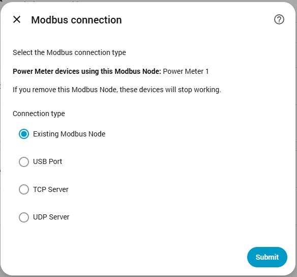
</p>

- **Modbus Node** – change the connection type and all its parameters. The Node reloads and the Power Meters continue with the new line. The first dialog lists **all Power Meters that use this Node**, so you know what is affected.
- **Power Meter** – change the Modbus Node, the Modbus ID, the read interval and the phase assignment. Reading of this meter is paused while the dialogs are open and resumes afterwards.

### 🗑️ Removing devices

- Removing a **Power Meter** simply removes the meter and its entities.
- Removing a **Modbus Node** that is still used by Power Meters makes them stop working. Home Assistant then raises a **Repair** (*Settings → System → Repairs*): *"Modbus Node of … is missing"*. Create a new Modbus Node and select it in the configuration of the affected Power Meter – the repair disappears by itself.

> 💡 Before removing a Modbus Node, check which Power Meters use it in the first dialog of its *Configure* window.

---

## 🌍 Languages

The user interface of the integration (all dialogs, errors, repairs and entity names) is available in:

| | | | |
|---|---|---|---|
| 🇬🇧 English | 🇸🇰 Slovak | 🇨🇿 Czech | 🇵🇱 Polish |
| 🇩🇪 German | 🇫🇷 French | 🇪🇸 Spanish | 🇷🇴 Romanian |
| 🇷🇺 Russian | 🇺🇦 Ukrainian | 🇹🇷 Turkish | |

The language follows the language selected in your Home Assistant profile; other languages fall back to English.

---

## 🩺 Troubleshooting

### 🔍 Enable debug logging

Add this to `configuration.yaml` and restart (or use the *Enable debug logging* button on the integration page):

```yaml
logger:
  default: warning
  logs:
    custom_components.power_meter_jsy: debug
```

### ❓ Common problems

| Symptom | Possible cause and solution |
|---------|------------------------------|
| *"Cannot read the device. Check the Modbus Node, Modbus ID and wiring."* | Wrong Modbus ID, wrong baud rate / parity / stop bits, swapped RS485 **A/B** wires, missing termination, or the Node points to the wrong port / address. Check the factory defaults (**ID 1, 9600, 8N1**). |
| USB port does not communicate, or the port is missing in the list | A serial port can have **only one owner**. If a Modbus hub from `configuration.yaml` uses the same adapter, it holds the port. Remove the hub, or use the **Existing Modbus Node** connection type instead. |
| Switching a Node from *USB* to *Existing Modbus Node* does not work immediately | The core Modbus integration retries a failed connection only every 60 s. The integration speeds this up, but the hub must be able to open the port – make sure nothing else holds it. |
| Error code sensor shows `1` | The serial port or connection could not be opened (wrong port, adapter unplugged, port in use). |
| Error code sensor shows `2` | The device did not answer (wrong ID, wiring, parameters, device powered off). |
| All sensors `unavailable` | Communication lost. Check the Error code sensor of the Modbus Node. The sensors return by themselves when the device answers again. |
| **Frequency** is `0 Hz` on a channel | The voltage of that channel is below 20 V (voltage input not connected). |
| Meter does not answer after changing its settings with **Tools** | Power-cycle the meter. Try the new settings first, then the factory defaults (ID 1, 9600, 8N1). |
| Data updates too slowly | The minimum read interval is 2 s because the meter answers slowly. Increase the interval if you share a long bus between many meters. |
| Two meters answer at the same time / garbled data | Two devices on one bus have the **same Modbus ID**. Give each meter a unique ID with **Tools** (connect them one at a time). |

### 📝 Log behaviour

When a device is offline the integration logs **one** error and then stays quiet (details only at debug level), followed by a single *"communication restored"* message when it returns.

---

## 🔬 Technical details

- **Protocol:** Modbus RTU (serial), Modbus TCP/UDP; library `pymodbus`.
- **Read:** function `0x03` (Read Holding Registers). All measurement values are read with **one request** – `12 channels × 7 registers = 84 registers` starting at `0x0040`.
- **Identification:** registers `0x0000 – 0x0003` – model code (`0x0138` = JSY-MK-138), voltage range, current range. Read when the device is added.
- **Register layout per channel (7 registers):**

  | Offset | Quantity | Scale |
  |:------:|----------|-------|
  | +0 | Voltage | 0.01 V |
  | +1 | Current | 0.001 A |
  | +2 | Active power | 1 W |
  | +3, +4 | Total active energy (32-bit, high word first) | 0.01 kWh |
  | +5 | Power factor | 0.001 |
  | +6 | Frequency | 0.01 Hz |

  Channel 1 starts at `0x0040`, every further channel is `+7` registers.
- **Phase assignment:** registers `0x0010 – 0x0015` (value `1` = phase A, `2` = phase B, `3` = phase C).
- **Communication parameters:** register `0x0004` – high byte = Modbus ID, low byte = data format (bits 7–6: `00` 8N1, `01` 8E1, `10` 8O1, `11` 8N2) + baud rate code (`6` = 9600, `7` = 19200, `8` = 38400). Written with function `0x10` (Write Multiple Registers), because the device protects the register against accidental writes.
- **Reliability:** minimum 0.2 s gap between two packets to the same device, automatic reconnect with one retry, extended timeouts during configuration writes, a hard limit on the duration of one read, serialised access to every line.
- **Integration type:** `device`, **IoT class:** `local_polling`, **config flow:** yes.

---

## 🚨 Disclaimer

**The use of this integration is at your own risk.** The integration can write the Modbus ID, the communication parameters and the phase assignment into your device; a wrong setting – especially the *Write via broadcast* option – can make devices on a bus unreachable until their settings are corrected. Any potential damage caused by the integration is the responsibility of the user. Electrical installation work must be performed by a qualified person.

This is an independent community project and is not affiliated with the manufacturer of the JSY devices.

---

## 🤝 Support

- 🐛 **Bugs and feature requests:** [GitHub Issues](https://github.com/jozef-moravcik-homeassistant/power-meter-jsy/issues)
- 📖 **Documentation:** this page
- 👤 **Author:** Jozef Moravčík
- 🏭 **Producer's website:** [JSY Products](https://www.jsypowermeter.com/products/)
- 📟 **Product site:** [JSY-MK-138](https://www.jsypowermeter.com/customized-oem-solar-single-phase-energy-meter-with-rs485-modbus-rtu-20ma-50a-jsy-mk-138-product/)

When reporting a problem, please include the Home Assistant version, the integration version, the connection type and a **debug log** (see [Troubleshooting](#-troubleshooting)).

---

<p align="center">Made with ❤️ for the Home Assistant community</p>
